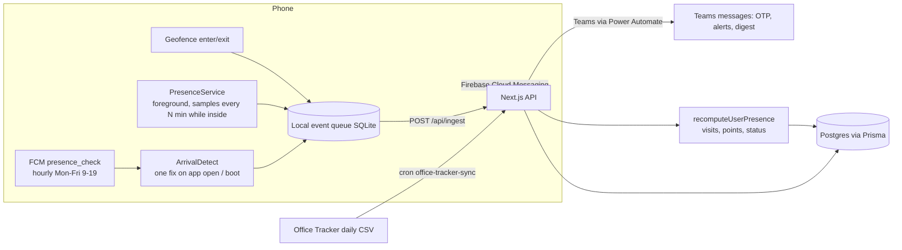

# Office Presence: Living Product and KT Document

| Field | Value |
|---|---|
| Product | Office Presence (PwC internal pilot) |
| Components | Android app (`com.pwc.officepresence`, Kotlin + Jetpack Compose) and Web app + API (Next.js App Router, Prisma, hosted on Vercel) |
| Production web | `https://office-presence-psi.vercel.app` (hard-coded in two places, see Gaps) |
| Current releases | Android 2.1.0 (versionCode 16). Web package `office-presence-web` 0.1.0 |
| Doc version | 1.16 |
| Last reviewed against code | 18 Nov 2026 (Android and web sources up to 16 Nov 2026, plus `schema.prisma`, `build.gradle.kts`, `package.json`) |
| Owner | _fill in_ |

> **How to use this document.** Part A explains the product in plain language. Part B is the user guide, Part C the admin guide, Part D the developer guide. Part E lists known gaps. Part F is the roadmap. Part G explains how to keep this file current. When a section changes, update it and add a line to the Change log at the bottom.

---

## Contents

- Part A. Product overview and core rules
- Part B. User guide (Android app and website)
- Part C. Admin guide (website, phone, runbooks)
- Part D. Developer guide (architecture, code map, API, data, jobs, config)
- Part E. Gap analysis (prioritised)
- Part F. Recommended next steps and screens
- Part G. Keeping this document alive
- Change log

---

# Part A. Product overview and core rules

## A1. What the product does

Office Presence records when an employee is physically at a PwC office, using the phone's location, and turns that into **office points** for the month. Each person has a monthly points target set by the admin (default 8). Employees see their status, month and year on the phone and the website. Admins see a live roster, approve corrections, manage users and offices, and set the rules.

For people who have not installed the phone app, visits are back-filled once a day from a separate system called **Office Tracker**.

## A2. Glossary

| Term | Meaning |
|---|---|
| **Office** | A named location with a centre point, a radius in metres (20 to 5000) and a **points per visit day** value (0 to 100). Status can be `active`, `inactive`, `pending` (suggested by a user) or `rejected`. Deleting an office sets it inactive and stamps `deletedAt`; past points stay. |
| **Fence** | The circle around an office. The phone registers Android geofences for every active office. |
| **Event** | One raw signal from a phone: `enter`, `exit`, `sample`, `check_in`, `check_out`, with time, coordinates, accuracy and Wi-Fi name. Stored in `PresenceEvent`. |
| **Visit** | A continuous stay at one office, built from events. Source is `auto` (phone), `manual`, `admin` or `correction`. |
| **Visit day** | A calendar day (in the policy timezone) with at least one visit. A single in-office fix with zero hours still counts as a visit day. |
| **Points** | A visit day earns the points of the **highest-value office** visited that day. Two offices on one day do not add up. |
| **Monthly target** | Points needed per month (policy `monthlyPointsTarget`, default 8). "Goal met" when reached. |
| **Suggested day hours** | Advisory only (policy `dayHours`). Never affects points. |
| **Gap** | Minutes with no inside evidence after which a visit is considered ended (policy `gapMinutes`). A sample that arrives one sample interval late is still treated as inside. |
| **Correction** | A request by an employee to change a day. Can be auto approved or need an admin. |
| **Correction window** | Days after month end during which the month can still be corrected (policy `correctionWindowDays`, default 5). After that the month is locked. |
| **View as** | An admin temporarily acting as another user, for support or testing. Read-only for real users, full for test accounts. Ends after 30 minutes. |
| **Test / dummy account** | Accounts flagged `isTestAccount` or `isDummy`, or emails ending `@example.pwc.local` or starting `dummy.`. Hidden from roster, reports and non-admin colleague lists. |
| **Developer mode** | A per-user switch that unlocks the phone's Developer screen (test gap, mock GPS help, queue tools). |
| **HR exception** | Points granted by HR or an admin for working days the person could not be in the office (client site, travel). Each covered working day counts the points of the chosen office (default the home office), stored at grant time. Revoked, never deleted. See A6. |
| **Leave / Holiday** | Records for information only. They never change the target or points. A holiday applies to one office or all offices. |
| **Manager** | `User.managerId`. A manager sees attendance for direct reports and for members of teams they lead. Not the whole sub-tree: a report's reports are out of scope. Managers have no admin powers. See C5. |
| **Team** | A label for grouping and filtering (`Team`, unique name, optional lead). The team lead sees members like a manager. Deleting a team moves members to No team. |

## A3. How presence is detected (end to end)



1. **Geofence enter** (Android) records an `enter` event, shows "arrived" notification and starts `PresenceService`.
2. **PresenceService** is a foreground service that asks for a high-accuracy fix every `sampleIntervalMinutes`. Each fix becomes a `sample` event. A fix with accuracy worse than the policy fence radius is stored but ignored for In/Out ("Looking for the office").
3. **Geofence exit** with good accuracy (better than 15 m) records `exit`, shows "left" notification and stops the service. A coarse exit is ignored, because the server keeps a visit open until the gap passes anyway.
4. **ArrivalDetect** takes one fix when the app opens or the phone boots, so someone already inside shows as In.
5. **Hourly presence ping**: an external cron calls the server, which sends an FCM `presence_check` to phones that have not been seen in 20 minutes (Mon to Fri, 09:00 to 19:00 in policy timezone). The phone takes one fix.
6. **Midnight split**: if the person is inside at local midnight, the service writes a `check_out` and `check_in` at the boundary so each day is counted separately.
7. Events queue locally and upload in batches of up to 100 to `/api/ingest`. Sample-only batches do a cheap status update. Any other event type triggers a full month recompute. After HTTP 200 the phone marks the whole batch sent, even when some events were ignored.
8. **Ingest trust** (`lib/ingest-trust.ts`, decided once at ingest and stored on `PresenceEvent.trusted` / `rejectReason`). Only a device token or a full view-as session may ingest; a web cookie gets 403 "Only the phone app can send presence". Per event:
   - More than 2 minutes in the future: skipped (`future`), not stored.
   - Older than 30 days: stored untrusted (`too_old`).
   - `enter` / `sample`: the server match from coordinates wins. A client office id that differs is noted as `client_office_mismatch` but stays trusted. With no server match, a device-token fix is still trusted when it lies within the claimed office's radius plus its own accuracy (indoor fixes). Otherwise untrusted: `no_location` (no coordinates) or `outside_office`. A sample outside every office with no claimed office stays trusted (it is Out evidence).
   - `check_in`: trusted only as the midnight pair (same time as a `check_out` in the batch or stored in the last 10 minutes) with trusted inside evidence for that office within gap plus one sample interval. Otherwise `unverified_check_in`.
   - `exit` and `check_out`: always trusted.
   - One bad event never fails the batch. The response adds `rejected` and `rejectedReasons`. Recompute reads only trusted, non-simulated events. A geofence enter without a location asks for a fresh fix (`ArrivalDetect.forceNow`).
9. The server rebuilds visits for the month from raw events + admin visits + exclusions, then computes points per day and the month total, and caches the result in `CurrentStatus`.

## A4. Visit and points rules (source of truth: `web/src/lib/visit-calculator.ts`)

The same algorithm is duplicated in Kotlin (`presence/VisitCalculator.kt`) so the phone can show results offline. The **server result always wins**.

- Events marked `simulated` are ignored. Untrusted events (`trusted = false`, set at ingest, see A3 step 8) are never passed to the calculator. The inside rules below are unchanged.
- A fix counts as inside an office when its accuracy is within the policy fence radius and it is within that office's radius. If several offices match, the nearest wins.
- A visit opens on the first inside event and stays open while inside evidence keeps arriving within the gap (plus one sample interval of tolerance).
- An `exit` does not close the visit immediately. It closes only if no inside evidence arrives within the gap. A `check_out` closes immediately.
- Moving to a different office closes the first visit and opens a new one. Travel time between offices does not count.
- Visits are split at local midnight.
- Admin visits replace phone evidence for the whole day they cover.
- Exclusions (from corrections or admin edits) cut time out of phone visits.
- Per day: points = the maximum points of any office visited that day. Hours = first In to last Out per office, with excluded periods removed, overlap counted once.
- Phone visits use the points stored on their events (`PresenceEvent.pointsAtMatch`, set at ingest from the matched office). A visit takes the highest snapshot among its events. Only events from before this field existed fall back to the office's current weight.
- Admin, correction and Office Tracker visits keep `Visit.pointsAwarded` exactly as stored. 0 means "day turned off". Changing an office's points never changes past days.

## A5. Correction rules (source: `lib/correction-approval.ts`, `lib/corrections.ts`)

Issue types: **A visit is missing**, **Times are wrong**, **Wrong office**, **This day should not count**.

A new request is checked in this order:

1. Month locked (more than `correctionWindowDays` after month end)? Rejected.
2. A pending request already exists for that day? Rejected (409).
3. Times in the future? Rejected. Visits may not overlap. Only the last visit can be "Still In".
4. Classification:
   - Policy "admin approves each one" on: **pending**.
   - Requester is an admin: **pending** (admins cannot auto approve themselves).
   - Person already used `correctionAutoApproveLimit` auto approvals this month: **pending**.
   - `correctionRequireSync` on and phone sent no data that day: **pending**.
   - Otherwise **auto approved** and applied immediately.

Statuses: `pending`, `auto_approved`, `approved`, `rejected`, `cancelled` (by requester), `undone` (requester undid their own applied correction), `reverted` (admin reverted an applied one, note required). When the only active admin raises a request, they may decide it themselves.

Admins get a daily Teams digest at 09:00 IST listing auto approved corrections from the last 24 hours (policy `correctionDailyDigest`).

The month lock (`isMonthLocked` in `lib/corrections-rules.ts`) uses the policy timezone: a month closes at local midnight `correctionWindowDays` days after month end (IST no longer closes 5.5 hours late).

## A6. Targets, leave and HR exceptions (source: `lib/exceptions.ts`, `lib/leave.ts`, `lib/holidays.ts`)

- **Target**: always `monthlyPointsTarget` (8) for everyone, every month. No pro-rating for joiners, leave or holidays.
- **Leave** (`LeaveDay`, kind `leave` or `other_duty`): one row per person per day, for information. Set by an admin on the person page (source `admin`) or by the employee when `allowSelfLeave` is on (source `self`). Blocked in a closed month.
- **Holidays** (`Holiday`): per office or all offices (`officeLocationId` null). Shown on calendars and reports. A weekend holiday has no effect. Holidays are skipped when an exception range is expanded.
- **HR exceptions** (`PresenceException` + one `PresenceExceptionDay` per working day):
  - Kinds: single day or several days (`days`, up to 62 calendar days) and whole month (`month`). Working days are Monday to Friday minus holidays for the chosen office.
  - Points per day = the chosen office's `pointsPerVisitDay` at grant time (Pune 4, Bengaluru 1). Changing office points later does not change the grant.
  - Applies immediately, like an admin approval. No correction request is created and the person's auto-approve allowance is not used. The month is recomputed.
  - Day points = the higher of the visit points and the exception points. Several exceptions on one day count once (the highest). A correction ("This day should not count") removes only visit points; the exception stays.
  - Revoke (reason required) sets `revokedAt`; revoked days stop counting. Nobody can grant or revoke their own.
  - Closed month: needs `allowExceptionsInClosedMonths` (default on), a confirm and a closed-month reason (appended to the stored reason). Off: refused.
  - Who: admins, and users with `canGrantExceptions` (HR). HR users only see `/admin/exceptions`; every other admin page and API still needs role admin.

---

# Part B. User guide

## B1. Getting started (Android)

1. Open the download page `/download` on the phone, allow installs from the browser, install the APK. If a debug build is installed, uninstall it first (different signing key).
2. **Sign in** with your `@pwc.com` email. Choose:
   - **Send code**: a 6-digit code arrives in Microsoft Teams, valid 10 minutes. Or
   - **Sign in with password**: only if you set one earlier in Profile, or an admin set one for you.
3. **Onboarding** (from app 2.1.0) runs after sign in whenever consent is missing or the notice version changed: Welcome, **Privacy** (summary plus "Read the notice"; **I agree** or **Not now (signs you out)**), **Location** (precise, then "All the time" via **Open settings**), **Notifications**, **Battery: Unrestricted**, Done. Tracking (geofences, arrival checks, the foreground service, uploads) does not start until the privacy notice is accepted. The Today screen still shows a banner until location is correct.
4. First sign in on an email creates your account automatically.

You can sign in on more than one phone. The latest location from any phone wins, and a day counts once.

## B2. Android screens

The app has five tabs at the bottom: **Today, Month, Year, Colleagues, You**.

### Today
| Element | What it does |
|---|---|
| Status card | **In** at an office with "Since hh:mm", or **Out**. "Checking location" while the first fix arrives. |
| Check now | Takes one GPS fix immediately and syncs. Short cooldown applies. |
| Today's visits | Each visit with office, In and Out time, "Still In" for an open visit, "Edited by you" if corrected. "Total today". Note: travel between offices is not counted. |
| Fix today | Edit today directly: **Change office**, **Split visit**, **Remove visit**, **Add a visit**, set In/Out times, add a **Reason**, then **Save changes**. Result is either "Today updated. Admins can see this change." (auto approved) or "Sent for approval." |
| Leave and holiday card | On a holiday: "Holiday: name" with "Your target stays 8 points." On a leave day: "On leave today" (or "On other duty today") with "Your target stays 8 points. If you come in, the visit still counts." From the last sync. Tracking keeps running. |
| Location banners | "Turn on location", "Allow location", "Open location settings" when permission or GPS is off. |
| Colleagues strip | Who is In right now (if you share your status). Taps through to Colleagues. |

### Month
| Element | What it does |
|---|---|
| Month switcher | Previous and next month. |
| Calendar | Marks visit days and "higher points" days, plus HR exception days (ring), holidays (grey, info) and leave (dashed, info), with a legend. The meter footer adds "Includes n HR exception days". Tap a day for detail. |
| HR exception day | Read only: "HR exception. Counts as N points (office)", office, reason, granted by and date, "Ask HR to change it." |
| Mark as leave | On a working day with no visit, in this or last month, when the rule allows it: Leave or Other duty, optional note, **Save leave**; **Remove leave** for leave you marked. "Leave is recorded for your records. Your target stays 8 points." Leave marked by an admin can only be removed by an admin. (`ui/compose/MonthLeave.kt`) |
| Day detail | Visits, offices, First In, Last Out, Counts as (points), total for the day. Shows correction state: Pending review, Approved, Auto approved, Not approved, Corrected by you. |
| Request a correction | Step 1 "What looks wrong?" (4 issue types). Step 2 "What should it be?" (visits, times, office, or remove the day). Step 3 Reason (admins see it). Step 4 "Check your request" with effect preview, then **Save correction** or **Send for approval**. |
| Pending request | **Cancel request**. |
| Applied correction | **Undo correction** (while the month is open and no later correction on that day is applied). |
| Rejected request | Shows the admin note, **Request again**. |

### Year
Points by month with goal markers (tap a month to open it), offices visited this year, visit days by weekday, usual arrival and leaving time, average hours per visit day, days with two or more offices, number of correction requests, days edited by an admin.

### Colleagues
List of colleagues who **share** their status, grouped In and Out, with search. You only see colleagues if you share too. If you do not share, a card explains what is shared (In or Out, since when, office name; never location, hours or points) with **Turn on sharing**.

### You
| Item | What it does |
|---|---|
| Profile | First name, last name, preferred name, how colleagues see your name (First and last, Preferred and last, Preferred only), email (read only). **Password**: set or change an optional sign-in password (8 to 128 characters, no spaces). |
| Share my status | Turn colleague sharing on or off. Takes effect immediately. |
| Privacy | Accepted notice version and date, **Read the notice**, what is kept and for how long, who can see visits, **Change sharing**, **Withdraw consent and stop tracking** (signs this phone out and revokes it). |
| Tracking | This phone's location permission, battery mode, last sync, **Sync now**, **Check now**, link to battery settings. |
| Devices | All phones signed in to your account. **Sign out device** remotely. |
| Correction requests | Open and decided requests with status. |
| Office nicknames | Personal name for an office. Only you see it. Colleagues still see the admin name. |
| Suggest an office | Name + address. Becomes a pending office that an admin approves. |
| Rules | Read-only view of the admin rules (gap, suggested hours, target, timezone, fence radius, sample interval, correction approval settings). |
| Today style | Visual style of the In/Out card. |
| Theme | Light, Dark, System. |
| Notifications | Per-type switches (Arrivals and leaving, Goal met, Weekly summary, Correction requests, Tracking problems), **Quiet hours** (time range, every day / weekdays / custom days, "still alert me for" tracking problems and correction decisions), Android channel sound/vibration, **Send test notification**. Saved to your account; each phone applies quiet hours in its own timezone. |
| Startup animation / sound | Toggle the launch animation and sound. |
| Developer | Only after turning on Developer (with confirmation). Opens the Developer screen. |
| My team (managers only) | "n of m below target this month" (from sync `team`, always against 8). Opens `/team` in the browser. Hidden during view-as. |
| Admin (admins only) | **View as another user**, **Admin console** (opens the website roster). |
| Sign out | Signs out this phone. |

### Phone notifications
Arrived at office, Left office, Goal met, Weekly summary (Monday 09:00 local: last week's visit days and month so far in points), Correction approved / Correction not approved (with the admin's note; tap opens Month on that month; the first sync after sign in is silent), HR exception added ("Fri 13 Nov counts as 1 point (Gurugram)."; seen ids kept like correction decisions, first sync silent, quiet hours apply, tap opens that day), Visits are not being counted (every 6 hours: location not All the time, location off, or no sync for 24 hours on a weekday; once per problem per 24 hours; tap opens You), App update available (once when a newer version is published, then once each weekday until this phone's version matches; tap opens the download page; opening the app asks again with Get the update), Signed out by admin. Quiet hours make them silent but they still appear. Personal alerts come to the phone. Teams is used for sign-in codes, and only sends personal alerts (arrival, goal met, Monday summary) to people with no active phone (none seen in 7 days). Teams alerts wait until quiet hours end.

## B3. Website for employees

Sign in at `/login` with the same Teams code or password. Pages in the left rail (bottom bar on mobile):

| Page | Path | Contents |
|---|---|---|
| My month | `/month` | Greeting, points meter ("x / y points", "n to go" or "Goal met", plus "Includes n HR exception days"), hours today, month calendar with HR exception, holiday and leave markers and a legend, day detail drawer (read-only HR exception detail; **Mark as leave** / **Remove leave** on a working day without a visit), **Request a correction** with preview. |
| My year | `/year` | Same statistics as the phone Year tab. Click a month to open it. |
| Colleagues | `/colleagues` | Searchable table: name, status, since, office. Filters by status and office. |
| Settings | `/settings?section=` | Sections: `profile` (names, display mode, password), `notifications`, `sharing` (share my status, devices), `privacy` (accepted version, **Accept the notice**, **Withdraw consent and stop tracking**: signs out every phone by push), `appearance` (theme), `nicknames`, `suggest`. |
| My team | `/team`, `/team/[userId]`, `/team/corrections` | Managers only (rail section "My team"; a "My team" tab on mobile). See C5. |
| Privacy notice | `/privacy` | Public page rendered from `src/content/privacy-notice.md` (draft, needs privacy and legal review). Linked from login and `/download`. |

---

# Part C. Admin guide

## C1. Becoming an admin

- The email in env var `ADMIN_EMAIL` becomes admin automatically on sign in.
- Any admin can make another user admin in **Users**.
- Guard rails: you cannot change your own role, deactivate or delete yourself, and the system blocks any change that would leave zero active admins.

Admins land on `/admin/roster` after sign in. They also keep all employee pages.

## C2. Admin pages (website)

### Roster `/admin/roster`
Live table of everyone (test accounts excluded): person (team under the name), status and since, office, month points (Met / Below target), hours today, last device. Grey badges under the name: "Mock GPS n" (mock location fixes this month, from app 2.1.0) and "Ignored n" (untrusted events this month), and "Not syncing" (has a phone, none synced in 24 hours, weekdays only). Search, office filter, team filter (including No team), manager filter, status filter, auto refresh with "Updated n m ago". Row actions: **Mark as Out** / **Clear In status** (fixes a stuck In). **Export CSV** (roster). Click a person to open their page.

### Person page `/admin/people/[id]`
Month switcher, day-by-day table (office, In, Out, time, counts as, phone), badges for Pending review, Corrected, Edited by admin, and a grey "n ignored events" note when ingest stored untrusted events that day (reasons in the tooltip, never counted).
- **Edit a day**: add, change or remove visits, change office, switch **Count this day** off (keeps visits but awards 0), **Reason** required. Applies immediately, no approval. The employee gets a Teams message.
- **Add a visit**: for a day the phone missed. Applies immediately.
- **Change history** for the day.
- **Mark as Out**, and for test accounts **Set In** at a chosen office (debug).
- **Export CSV** for that person and month.
- You cannot edit your own visits. Another admin must do it.
- **Add exception** opens Exceptions with the grant drawer for this person. **Mark leave** (date, Leave or Other duty, note). Day rows show a grey "HR exception" badge with **Revoke**, "Leave, marked by ... Info only" with **Remove**, and "Holiday: name. Info only". The summary shows "Includes n HR exception days" and the home office.

### Exceptions `/admin/exceptions`
For admins and HR users (`canGrantExceptions`). Filters: search, month, office, status (Active, Revoked, All). Table with person, dates, office, days, points, reason, granted by. **Export CSV**. **Add exception** drawer: person, type (Single day, Several days, Whole month), dates or month, office (defaults to home office), live preview ("N working days. X points a day." and the month effect on the 8 point target), reason (required), HR reference. A closed month adds a confirm and a reason. **Revoke exception** needs a reason.

### Holidays `/admin/holidays`
Year switcher and office filter. **Add holiday** (date, name, all offices or selected offices). **Import CSV** (`date,name[,office]`, blank office = all offices): **Check file**, then **Import n rows**. **Delete** is blocked in a closed month. Copy: "Holidays are shown on calendars and reports. Targets stay 8 points."

### Corrections `/admin/corrections`
Tabs: Pending, Approved, Auto approved, Reverted, Rejected, Cancelled, All. Filters by office and name. Counters including "Oldest pending". Open a request to see **Recorded** vs **Requested** and the effect on points. Actions:
- **Approve** (optionally **Edit before approving**).
- **Not approved** with a required note to the person.
- **Revert** an applied correction (note required).
Admins cannot decide their own requests, unless they are the only active admin.

### Users `/admin/users`
Tabs: Active, Admins, Test accounts, Deactivated. Filters: search, role, home office, status. Columns: person, role, home office, status, phones, last seen.
- **Add user**: full name, PwC email (test accounts may use `@example.pwc.local`), home office, role, test account flag. No invite is sent; they sign in with a Teams code.
- **User drawer**: edit names, email, role, home office, display mode; **Set password** / **Remove password**; list and **Sign out** devices; **API activity** for their phones; **Deactivate** (keeps history, signs out every phone via push) / **Reactivate**; **Delete permanently** (confirm by typing email).
- **Team** and **Manager** (edit drawer, after Home office): team picker and a searchable manager field. A loop is blocked ("A person cannot report to someone they manage"). Audited as `user.team_set` / `user.manager_set`.
- **Import managers and teams**: CSV `email,managerEmail,teamName`. **Check file** shows "n updates, n new teams, n problems" with problem lines (unknown person, unknown manager, this would make a loop); **Import n rows** applies valid rows only and creates missing teams. A blank cell leaves that field as it is. Audited as `team.import`.
- **Can grant HR exceptions** switch (role user only): opens the Exceptions page only, no roster or visit edits. Audited as `user.exceptions_on` / `user.exceptions_off`. The home office hint says HR exception days count that office's points.
- **View as**: real users read only; test accounts full ("Start testing"), where tracking on that session counts for the test account. Ends after 30 minutes, on **End**, or when the tab closes. A banner shows while active.

### Teams `/admin/teams`
Team list on the left (with member counts and No team), lead and members on the right. **New team**, **Rename**, **Delete team** (members move to No team), lead picker, **Add people**, **Remove**. Audited as `team.create`, `team.update`, `team.delete`.

### Offices `/admin/offices`
Map and list. **New office**: search an address (OpenStreetMap Nominatim) or click the map, set name, radius (m) and counts as (points). Actions: edit, **Deactivate**, **Activate**, **Delete** (soft). **Suggestions to review**: approve (optionally rename and set points) or reject user suggestions. Office detail page `/admin/offices/[id]` with map.
API-only today: bulk create from CSV (`name,latitude,longitude,radiusMeters,pointsPerVisitDay[,addressLabel]`).

### Reports `/admin/reports`
Monthly table per person: office, visits, points vs target, hours, HR exception days, leave, holidays (current month, from `/api/admin/status?records=1`). Filters: month, office, team, manager. Summary: people, goal met, below target. **Export CSV** adds `exceptionDays`, `exceptionPoints`, `leaveDays`, `holidays`; the person CSV adds `hr_exception`, `leave` / `other_duty` and `holiday` rows.

### Rules `/admin/settings` (labelled "Rules")
| Setting | Field | Notes |
|---|---|---|
| Monthly target | `monthlyPointsTarget` | Points per month for everyone. Same every month; leave and holidays are recorded only. |
| Employees can mark their own leave | `allowSelfLeave` (true) | Leave is information only. |
| HR exceptions | (link) | Opens `/admin/exceptions`. |
| Allow exceptions in closed months | `allowExceptionsInClosedMonths` (true) | Needs a confirm and a reason. Always logged. |
| A visit ends after a gap of | `gapMinutes` | Minutes with no inside samples. |
| Location sample | `sampleIntervalMinutes` | Shown as "set by the app". |
| Default office radius | `fenceRadiusMeters` | Used for new offices **and** as the maximum GPS accuracy accepted for any fix. |
| Ignore mock GPS for real accounts | `rejectMockLocations` (true) | Mock location fixes from real accounts are stored untrusted (`mock_location`). Test and dummy accounts always count. The flag needs app 2.1.0: phones on 2.0.7 or older cannot send it. |
| Keep raw location for | `rawLocationRetentionDays` (90) | 7 to 3650 days. A daily job clears latitude, longitude and Wi-Fi from older location events. Visits are kept. |
| Privacy notice version | `privacyNoticeVersion` ("1") | Raise it when the notice changes; phones ask everyone to accept again. |
| Require consent | `requireConsent` (false) | When on, ingest rejects events from users without the current consent (`consent_required`). Turn on after most phones are on app 2.1.0. |
| Suggested day | `dayHours` | Advice only. |
| Correction requests close | `correctionWindowDays` | Days after month end. |
| Correction approval | `correctionRequiresApproval` | Admin approves each one vs auto approve. |
| Auto approve up to | `correctionAutoApproveLimit` | Per person per month. |
| Ask an admin when no phone data | `correctionRequireSync` | |
| Daily digest | `correctionDailyDigest` | Teams message at 09:00. |
| Managers can decide their team's corrections | `managersDecideCorrections` (false) | Managers never decide their own. Approve or Not approved only. |
| Default timezone | `timezone` | Decides which day a visit falls on. |
| Android version code / name / APK URL | `appVersionCode`, `appVersionName`, `appApkUrl` | Phones on an older code are notified once, then once each weekday until they install it. Opening the app asks them to open the download page. Name and URL show on `/download`. |

Saving pushes `rules_changed` to all phones and `app_update` to phones on an older version.

**Import from Office Tracker** card: upload a CSV, **Check file** (dry run), then **Import visits**. Shows last daily sync status.

## C3. Admin on the phone
Under **You → Admin**: **View as another user** (search; test accounts full, real users read only; other admins not listed) and **Admin console** (opens the website). All other admin work is on the website.

## C4. Admin runbooks

**Onboard a person.** Nothing required: they sign in with Teams code. Optional: pre-create in Users with home office. Share `/download`.

**Offboard a person.** Users → Deactivate. Phones are signed out by push. History stays. Avoid Delete permanently unless legally required.

**Teams code not arriving.** Check Power Automate flow and env vars. Workaround: Users → Set password for that person.

**Person shows In after leaving.** Roster → Mark as Out. Ask them to check location is "All the time" and battery is Unrestricted.

**Phone missed a day.** Person page → Add a visit (with reason), or ask the person to raise a correction.

**Grant an HR exception.** Exceptions → Add exception (or the person page → Add exception). Choose the person, Single day / Several days / Whole month, the dates, and the office (home office by default). Check the preview, add a reason and the HR reference, then Grant exception. It counts at once. For a closed month tick the confirm and give a reason. To undo, open the row and Revoke exception with a reason. To let an HR colleague do this: Users → their drawer → Can grant HR exceptions.

**Load the holiday calendar.** Holidays → Import CSV → Check file → Import. Add one-off holidays with Add holiday.

**Set up managers and teams.** Users → Import managers and teams (`email,managerEmail,teamName`) → Check file → Import. Or Teams → New team, choose a lead, Add people, and set each person's Manager in the Users drawer. After the first import, raise the privacy notice version in Rules so everyone sees the manager wording.

**Add an office.** Offices → New office → search address → set radius (start with 100 to 150 m for a building) and points → Save. Phones re-register geofences on next sync.

**Change office points.** Offices, edit the office, change Points, Save office, then confirm "Change points". Past days keep the points they were recorded with. New visits from now on count the new value.

**Release a new Android build.** Build signed APK → upload (GitHub Release or `/public/downloads`) → Rules: set version code, name, APK URL → Save. Phones get a push.

**Reset data.** Users, open a test account, **Reset test data**, type the person's email and a reason (at least 10 characters). Deletes that one person's events, visits, exclusions, alerts and live status; the account and phones stay. Rules: `userId` is required (there is no all-users wipe), the caller must be a real admin outside view-as, admins cannot reset themselves, and real accounts can only be reset when the server has `ALLOW_REAL_USER_RESET=1` (otherwise 403 "Real accounts cannot be reset here"). An audit row `presence.reset` records the counts and the last 3 months' points and visit days before anything is deleted.

## C5. Manager guide

**Who is a manager.** Anyone with at least one active direct report (`User.managerId`) or who leads a team with members. Scope is direct reports plus members of teams you lead, not their reports in turn. Admins can also be managers. Managers get no admin powers: no roster, no visit edits, no HR exceptions.

**What managers see** (regardless of colleague sharing): In or Out today with the office and since when, month points against the 8-point target with HR exception days marked, visit days for the month with office and first In and last Out, leave and holidays as information, and correction requests with their status. Never coordinates, hours, device names, Wi-Fi, leave notes or the HR exception reason. Stated in the privacy notice under "Who can see it".

| Page | Contents |
|---|---|
| My team `/team` | Stats (people, In now, met, below), search, team filter, **Below target only**, **Export CSV**. Table: person (team), Today (In office or Out, "On leave" as info), month points "x / 8" with Met or Below and "Includes n HR exception days", Days left (working days to month end, minus holidays), Pending requests. Empty state: "No one reports to you yet. Admins set managers in Users." |
| Team member `/team/[userId]` | Banner "Read only. Ask an admin to change visits." Month switcher, meter, calendar with visit, HR exception, holiday and leave markers, day list (office, first In, last Out, points), correction requests. Out of scope shows "Not in your team". |
| Team corrections `/team/corrections` | Only when Rules → **Managers can decide their team's corrections** is on. Pending requests from people in scope. Drawer with **Approve** and **Not approved** (note required). No Revert, no Edit. A manager's own requests never appear and go to an admin. Audited as `correction.manager_approve` / `correction.manager_reject` plus the usual `correction.approve` / `correction.reject`. |

On the phone: You → **My team** shows "n of m below target this month" and opens `/team` in the browser.

---

# Part D. Developer guide

## D1. Architecture

| Layer | Technology |
|---|---|
| Android | Kotlin, Java 17, Jetpack Compose (BOM 2024.06.00, Material 3) + some legacy XML Activities, Play Services Location 21.3 (fused provider + geofencing), WorkManager 2.9, SQLite local queue, EncryptedSharedPreferences (security-crypto), Firebase BOM 33.7 (Messaging, Analytics, Performance, Crashlytics). minSdk 26, target/compile SDK 34 |
| Web UI | Next.js 15.5 App Router, React 19.1, plain CSS (`globals.css`, `tokens.css`), Leaflet 1.9 for maps |
| API | Next.js route handlers under `src/app/api`, zod 3 validation on ingest, `jose` 6 JWT, `bcryptjs` 3 |
| Data | Prisma 6.19 on PostgreSQL (`DATABASE_URL` pooled, `DIRECT_URL` for migrations) |
| Auth | Web: HS256 JWT in `op_session` cookie, 14 days (`jose`). Phone: opaque device token, bcrypt-hashed, looked up by 8-char prefix, sent as `Bearer`. View-as: separate signed JWT (`view_as_session` cookie or Bearer). |
| Messaging | Teams messages via Power Automate webhook. Push via Firebase Admin. |
| Geocoding | OpenStreetMap Nominatim, server-side, throttled 1 req/s per instance, in-memory cache |
| Hosting | Vercel (code comments reference the Hobby plan). Hourly jobs need an external cron caller. |
| External system | Office Tracker (`office-tracker-theta.vercel.app`) daily CSV export |

## D2. Repository map: web (`src/`)

| Path | Purpose |
|---|---|
| `app/page.tsx` | Redirect: admin → `/admin/roster`, user → `/month`, signed out → `/login` |
| `app/login/` | Teams code and password sign in |
| `app/download/` | APK download page (reads version/URL from policy) |
| `app/month/`, `app/me/MeClient.tsx` | My month (`/me` redirects to `/month`) |
| `app/year/` | My year |
| `app/colleagues/`, `app/peers/PeersClient.tsx` | Colleagues (`/peers` redirects) |
| `app/settings/` | User settings |
| `app/admin/AdminClient.tsx`, `admin/roster/` | Roster |
| `app/admin/people/[id]/` | Person month and day edits |
| `app/admin/corrections/` | Correction review |
| `app/admin/users/` | User management (`users/[id]` redirects to people) |
| `app/admin/offices/` | Offices + map |
| `app/admin/reports/` | Monthly report |
| `app/admin/exceptions/` | HR exceptions list, grant drawer, revoke modal (admins and `canGrantExceptions` users) |
| `app/admin/holidays/` | Holiday calendar, add and CSV import |
| `app/admin/settings/` | Rules + Office Tracker import |
| `app/dev-frames/`, `app/__frames/`, `frames/` | Design previews. Disabled in production unless `ALLOW_FRAME_PREVIEWS=1` |
| `components/` | `AppShell` (rail + bottom nav + view-as banner), `OfficeMap`, `TimeClock`, `PointsMeter`, `ThemeSwitch`, `op/DesignKit` |
| `lib/auth.ts`, `lib/actor.ts` | Sessions, view-as, `resolveActor` (cookie, then view-as Bearer, then device Bearer) |
| `lib/otp.ts`, `lib/password.ts` | OTP and password sign in, device token issue/verify |
| `lib/visit-calculator.ts` | Core visit and points algorithm |
| `lib/presence.ts` | Recompute month, current status, alert queue |
| `lib/corrections*.ts`, `lib/correction-*.ts` | Correction parsing, classification, apply, undo, revert |
| `lib/admin-day-edits.ts` | Admin day edits |
| `lib/policy.ts` | Singleton policy row (id 1) |
| `lib/offices*.ts`, `lib/office-input.ts` | Office queries, Nominatim, input parsing |
| `lib/office-tracker-*.ts` | Office Tracker CSV parse, apply, sync status |
| `lib/firebase-admin.ts` | Push: force sign out, presence check, rules changed, app update |
| `lib/notifications.ts` | Teams webhook |
| `lib/roster.ts`, `lib/year-stats.ts`, `lib/export-csv.ts` | Admin roster, year stats, CSV |
| `lib/display-name.ts`, `lib/format.ts`, `lib/points-format.ts` | Naming and copy helpers |
| `lib/consent.ts`, `lib/retention.ts`, `lib/privacy-notice.ts` | Consent state and ingest gate, daily retention purge, privacy notice loader |
| `lib/exceptions.ts`, `lib/exception-days.ts` | HR exception range, preview, grant, revoke; exception day queries for recompute |
| `lib/leave.ts`, `lib/holidays.ts`, `lib/month-records.ts`, `lib/employee-records.ts` | Leave set and clear (and the self-leave rules), holiday lookups and CSV parse, per-person month counts for reports, the person's own records for sync and My month |
| `lib/team-scope.ts`, `lib/team-view.ts`, `lib/team-import.ts`, `lib/team-filters.ts` | Manager scope and loop check, allow-listed manager payloads (status, member month, days left), managers and teams CSV import, Roster and Reports filter options |
| `app/team/*`, `app/admin/teams/*` | My team, member month, team corrections; admin Teams page |
| `content/privacy-notice.md`, `app/privacy/` | Privacy notice text (draft) and public page |

## D3. Repository map: Android (`java/com/pwc/officepresence/`)

| Path | Purpose |
|---|---|
| `OfficePresenceApp.kt` | App init: Crashlytics keys, theme, FCM token upload |
| `ui/LoginActivity.kt` | Launcher. Teams code + password sign in |
| `ui/ShellActivity.kt` | Main app: five-tab Compose shell, permission prompts, view-as |
| `ui/compose/TodayScreen.kt`, `FixTodayMerge.kt`, `OfficeStays.kt`, `TodayStyle*.kt` | Today tab and Fix today |
| `ui/compose/MonthScreen.kt`, `MonthLeave.kt` | Month tab, day detail, correction wizard; holiday, leave and HR exception records, markers, leave action, Today notice |
| `ui/compose/MyTeamRow.kt` | You → My team row for managers (opens `/team` in the browser) |
| `notify/ExceptionNotices.kt` | Which new HR exceptions from sync to notify, and the notice text |
| `ui/compose/YearScreen.kt` | Year tab |
| `ui/compose/ColleaguesScreen.kt` | Colleagues tab |
| `ui/compose/YouScreen.kt`, `ProfileScreen.kt`, `NotificationsScreen.kt`, `QuietHoursScreen.kt`, `AccountSheet.kt` | You tab and sub-screens |
| `ui/compose/OnboardingScreen.kt`, `PrivacyScreen.kt`, `data/TrackingConsent.kt` | Post sign-in onboarding (privacy consent, permissions), You > Privacy, consent rules |
| `ui/compose/ViewAsScreens.kt`, `ViewAsBanner.kt` | Admin view as |
| `ui/compose/Op*.kt`, `ui/theme/` | Design system components, colours, motion, formatting |
| `ui/DeveloperActivity.kt` | Developer tools |
| `ui/MainActivity.kt`, `ReportsActivity.kt`, `AdminActivity.kt`, `SettingsActivity.kt`, `PeersActivity.kt` | **Legacy XML screens, not reachable from the current app** |
| `data/ApiClient.kt` | HTTP client for every API call |
| `data/AppPrefs.kt` | All local settings, the device token and cached state, stored in EncryptedSharedPreferences (AES-256) |
| `data/EventLog.kt` | SQLite queue of local events |
| `data/PresenceRepository.kt` | Upload queue, sync, apply server state, force detect, sign out |
| `presence/PresenceService.kt` | Foreground location sampling and midnight split |
| `presence/GeofenceHelper.kt`, `GeofenceReceiver.kt` | Geofence register and transitions |
| `presence/ArrivalDetect.kt` | One-shot fix on open/boot/push |
| `presence/VisitCalculator.kt` | Kotlin copy of the visit algorithm, including `mergeExceptionDays` (day points = max of visit and HR exception) |
| `presence/BootReceiver.kt`, `MidnightBoundary.kt` | Reboot and midnight handling |
| `notify/Notifier.kt` | Channels, quiet hours, all notifications |
| `notify/WeeklySummaryWorker.kt`, `SyncRefreshWorker.kt` | Monday 09:00 weekly summary, daily sync refresh |
| `notify/AppUpdateWorker.kt`, `AppUpdateCheck.kt` | Once a day on the phone, and a prompt each time the app is opened, while the installed version is behind |
| `notify/TrackingHealthWorker.kt`, `CorrectionDecisions.kt` | 6-hourly tracking checks; which sync decisions to notify |
| `notify/OfficeFirebaseMessagingService.kt`, `FcmTokenSync.kt`, `PresenceCheckAction.kt` | Push handling |
| `update/AppUpdate.kt`, `UpdateInstallReceiver.kt` | In-app APK download and install |

Build settings are in D12. Still not shared: `google-services.json`, `settings.gradle.kts`, the Android test folder.

## D4. Authentication and roles

| Client | Sign in | Credential | Lifetime |
|---|---|---|---|
| Web | `POST /api/auth/otp/verify` or `/api/auth/password/login` | `op_session` httpOnly cookie (JWT: sub, email, role, name) | 14 days |
| Android | Same endpoints with `client: "android"`, `installId`, `deviceName` | Device token (64 hex chars), stored hashed; re-login on same install revokes the old one | Until revoked |
| View as | `POST /api/admin/view-as` | `view_as_session` cookie (web) or Bearer token (phone), plus `ViewAsSession` row | 30 minutes |

Helpers: `requireAdmin()` (web cookie only, effective user), `requireAdminActor()` (cookie or device, effective user), `requireRealAdminActor()` (real admin even during view-as), `requireExceptionGranter()` (admin or `canGrantExceptions`, never during view-as; only the `/api/admin/exceptions*` routes use it). Manager routes (`/api/team/*`) use `resolveActor` plus `lib/team-scope.ts` (`managedUserIds`, `canManage`); ids from the client are always checked against scope, and manager decisions are refused during view-as. Read-only view-as blocks writes via `rejectIfReadonlyViewAs`.

Allowed emails: `@pwc.com`. Password sign in also allows test emails.

**Sign-in limits** (`lib/rate-limit.ts`, Postgres table `AuthThrottle`, one atomic upsert per attempt):

| Action | Limit | Lock |
|---|---|---|
| Request a code | 5 per email per hour, 30 per IP per hour | Until the hour window ends |
| Wrong code | 5 per email per 15 minutes (also 50 per IP) | 15 minutes. On the 5th failure every unused code for that email is marked used, so a new code is needed |
| Wrong password | 5 per email per 15 minutes, 50 per IP per 15 minutes | 15 minutes |

The lock is checked before any bcrypt work. Success clears the email failure key. A blocked call returns 429 with `Retry-After` and `{ error: "Too many attempts. Wait 15 minutes, then try again.", retryAfterSeconds }`. Wrong codes and passwords keep their generic messages, and unknown emails count the same way. Codes come from `crypto.randomInt`. Web and phone show a countdown ("Send code in 14:32", "Verify in 14:32") and keep the unlock time locally so it survives a restart (frames 1.1 and 2.1).

## D5. API reference

**Public / auth**

| Method | Path | Purpose |
|---|---|---|
| POST | `/api/auth/otp/request` | Send Teams code |
| POST | `/api/auth/otp/verify` | Verify code, create session or device token, auto-create user |
| POST | `/api/auth/password/login` | Password sign in (does not create users) |
| POST | `/api/auth/logout` | Clear cookies |
| GET | `/api/health` | Health and contract `points-v1` |

**Signed-in user (cookie or device token)**

| Method | Path | Purpose |
|---|---|---|
| POST | `/api/ingest` | Upload up to 100 events. Device token or full view-as only (403 otherwise). 403 `consent_required` when Rules "Require consent" is on and the user has not accepted the current notice. Latitude, longitude and Wi-Fi are stored only for events matched to an office. Response adds `rejected` and `rejectedReasons` (A3 step 8) |
| GET | `/api/me/sync` | Full state for the phone, including `consent`, `holidays`, `leaveDays`, `exceptionDays` (dayKey, points, officeName, homeOffice, reason, grantedBy, grantedAt) for the last 3 months, and `exceptionsAdded` (active grants from the last 14 days: id, days, pointsPerDay, officeName). `user.isManager`, and `team: { people, belowTarget }` for managers (null otherwise). `?months=` versions for 304. `?recompute=1` forces recompute |
| PUT, DELETE | `/api/me/leave/[date]` | Mark leave `{ kind: leave\|other_duty, note }` or remove it. Only when `allowSelfLeave`, a working day for the home office, in the current or previous month, and the month is open. 403 in read-only view-as and for leave an admin marked. Audits `leave.self_set`, `leave.self_clear` |
| GET, POST, DELETE | `/api/me/consent` | Consent state (`requiredVersion`, `acceptedVersion`, `acceptedAt`, `accepted`, `required`, `retentionDays`, `noticeUrl`); accept `{ version }` (must equal the current version); withdraw (phone: revokes this device; web: pushes `force_sign_out` and revokes every device). View-as gets 403. Audits `privacy.consent`, `privacy.withdraw` |
| GET | `/api/me/reports?month=` | Month view. Adds `holidays`, `leaveDays`, `exceptionDays`, `exceptionsAdded`, `exceptionDayCount`, `allowSelfLeave`, and `exception` on each calendar day |
| GET | `/api/me/year?year=` | Year stats |
| GET | `/api/team/status` | Managers only (403 when no one is in scope). `month`, `pointsTarget`, `canDecideCorrections`, `stats` (people, inNow, goalMet, belowTarget), `people` (id, name, email, teamName, inOffice, sinceAt, officeName, monthPoints, pointsTarget, goalMet, exceptionDays, onLeaveToday, daysLeft, pendingRequests) |
| GET | `/api/team/people/[userId]/month?month=` | Read-only month for one person in scope (403 otherwise): person, meter fields, `days` (dayKey, points, officeName, firstIn, lastOut, exception { points, officeName }), holidays, leaveDays (dayKey, kind), corrections (id, dayKey, status, dates) |
| GET, POST | `/api/team/corrections` | Only when `managersDecideCorrections` (403 otherwise). GET: pending requests for people in scope. POST `{ id, decision: approve\|reject, reviewNote }`: note required for reject; own, out-of-scope and view-as get 403; already decided 409. Audits `correction.manager_approve\|manager_reject` |
| GET, POST | `/api/me/corrections` | List; create, `action: cancel`, `action: undo` |
| GET | `/api/me/corrections/preview` | Effect preview |
| GET, PATCH | `/api/me/profile` | Names, display mode |
| GET, PUT, DELETE | `/api/me/password` | Password status, set, clear |
| GET, PATCH | `/api/me/notification-prefs` | Notification and quiet hours |
| GET, PATCH | `/api/me/privacy` | Share with colleagues |
| GET, PATCH, DELETE | `/api/me/devices` | List, rename, FCM token, revoke |
| PUT | `/api/me/aliases` | Office nickname |
| POST | `/api/me/offices/suggest` | Suggest office by address |
| PATCH, POST | `/api/me/developer` | Developer mode; `suggest_office` at current GPS |
| POST | `/api/me/fence` | Legacy "set office here" |
| GET | `/api/offices`, `/api/policy` | Offices with nicknames; policy |
| GET | `/api/peers/presence` | Colleagues (only if you share) |
| GET, POST | `/api/corrections`, `/api/corrections/preview` | Aliases of the `/api/me/...` routes |

**Admin**

| Method | Path | Purpose |
|---|---|---|
| GET, POST | `/api/admin/teams` | List teams (lead, members with manager, `noTeamCount`); create `{ name, leadUserId }` |
| PATCH, DELETE | `/api/admin/teams/[id]` | Rename or set the lead `{ name, leadUserId }`; delete (members move to No team) |
| POST | `/api/admin/imports/users?dryRun=` | CSV `email,managerEmail,teamName` (text/csv or `{ csv }`). Returns rows, changes, problems, newTeams. Real admin only |
| GET | `/api/admin/status` | Roster and report data. `team` (id or `none`) and `manager` filters; rows add teamId, teamName, managerId, managerName. `?records=1` adds this month's `exceptionDays`, `exceptionPoints`, `leaveDays`, `holidays` per person |
| GET, POST | `/api/admin/exceptions` | HR exceptions list (`month`, `office`, `status` active, revoked or all, `userId`); grant `{ userId, kind: days\|month, startDay, endDay, monthKey, officeLocationId, reason, reference, confirmClosedMonth, closedMonthReason }`. 409 with `lockedMonths` when a closed month needs the confirm. Admin or `canGrantExceptions` |
| GET | `/api/admin/exceptions/preview` | Working days, points per day, month effect (`before`, `added`, `after`, `locked`) |
| POST | `/api/admin/exceptions/[id]/revoke` | `{ reason }` |
| GET | `/api/admin/exceptions/people?q=` | Person search for the grant drawer (name, email, home office and its points) |
| GET, POST, DELETE | `/api/admin/holidays` | List by `year` (plus offices); add `{ dayKey, name, officeIds[] }` or import `{ csv, dryRun }`; delete `{ ids }` or `?id=` (blocked in a closed month) |
| PUT, DELETE | `/api/admin/people/[userId]/leave/[date]` | Mark leave `{ kind: leave\|other_duty, note }`; remove |
| GET | `/api/admin/export?kind=roster\|reports\|person` | CSV |
| GET, POST | `/api/admin/corrections` | List; approve, reject, revert |
| GET, PATCH | `/api/admin/policy` | Rules |
| GET, POST, PATCH, DELETE | `/api/admin/offices` | Offices (single or bulk CSV) |
| POST | `/api/admin/offices/pending` | Approve or reject suggestion |
| GET | `/api/geo/search`, `/api/geo/reverse` | Nominatim proxy |
| GET, POST, DELETE | `/api/admin/users` | List, create, seed dummies, set presence, legacy delete |
| GET, PATCH, DELETE | `/api/admin/users/[id]` | Detail, edit, delete |
| PUT | `/api/admin/users/[id]/password` | Set or clear password |
| POST | `/api/admin/users/[id]/deactivate`, `/reactivate` | |
| GET | `/api/admin/users/[id]/api-activity` | Phone API calls |
| POST | `/api/admin/view-as`, `/view-as/end`; GET `/view-as/status` | View as |
| GET | `/api/admin/people/[userId]/history` | Day change history |
| PUT | `/api/admin/people/[userId]/days/[date]` | Replace a day |
| POST | `/api/admin/people/[userId]/visits` | Add a visit |
| POST, PATCH, DELETE | `/api/admin/visits` | Legacy visit edits |
| GET | `/api/admin/reports` | Report data |
| POST | `/api/admin/imports/office-tracker?dryRun=` | Manual Office Tracker import |
| POST | `/api/admin/reset` | Delete one person's presence data. Body `{ userId, confirm: <their email>, reason }` (C4 Reset data) |

**Cron** (header `Authorization: Bearer $CRON_SECRET` or `?secret=`)

| Path | Schedule | Purpose |
|---|---|---|
| `/api/cron/presence-ping` | Every ~60 min, Mon to Fri | FCM `presence_check` inside 09:00 to 19:00 policy time. The first call of that window also sends `app_update` to phones still on an older version (once that day). |
| `/api/cron/app-update` | Optional, any day | Same daily `app_update` reminder. Use it to cover days the presence ping does not run. |
| `/api/cron/correction-digest` | Hourly is fine; acts only at 09:00 IST once per day | Teams digest to admins |
| `/api/cron/office-tracker-sync` | Daily | Pull Office Tracker CSV, import for people without an active phone |
| `/api/cron/retention` | Daily (header only, no `?secret=`) | Clear coordinates and Wi-Fi on events older than `rawLocationRetentionDays` (batches of 5000), delete OTP codes older than 24 hours, idle unlocked `AuthThrottle` rows, view-as sessions ended over 180 days ago. Audits `privacy.retention` |

The cron schedule lives outside this repo (external caller). Record it here: _fill in_.

## D6. Push messages (FCM data)

| `type` | Sent when | Phone action |
|---|---|---|
| `force_sign_out` | User deactivated or deleted, device revoked | Clear session, open login |
| `presence_check` | Hourly cron | One GPS fix and upload |
| `rules_changed` | Policy saved | Sync |
| `app_update` | Policy version code above the phone's, once when published and again once each weekday until the phone catches up | Notification opens `/download`. Opening the app asks to open that page. |
| `correction_decided` (`id`, `dayKey`, `status`) | Admin approves, does not approve, or reverts a correction. Not sent for auto-approved ones. | Full sync (no month versions, so never 304). New approved or not approved decisions then notify once. |

## D7. Data model (from `prisma/schema.prisma`)

PostgreSQL. All ids are `cuid()` strings except `Policy` (integer 1). "Cascade" means the row is deleted when its user is deleted.

**Enums**

| Enum | Values |
|---|---|
| `Role` | `user`, `admin` |
| `VisitSource` | `auto`, `manual`, `admin`, `correction` |
| `EventType` | `enter`, `sample`, `exit`, `check_in`, `check_out` |
| `AlertType` | `login_otp`, `hours_started`, `hours_met`, `points_met`, `daily_summary` |
| `OfficeStatus` | `active`, `pending`, `rejected`, `inactive` |
| `CorrectionStatus` | `pending`, `approved`, `rejected`, `cancelled`, `auto_approved`, `reverted`, `undone` |
| `CorrectionIssue` | `missing_visit`, `wrong_times`, `wrong_office`, `should_not_count` |

**Models**

| Model | Fields (defaults in brackets) | Relations and indexes |
|---|---|---|
| `User` | email (unique), name, firstName, lastName, preferredName, colleagueDisplayMode (`first_last`, also `preferred_last`, `preferred_only`), homeOfficeId, role (`user`), timezone (`Asia/Kolkata`), developerMode (false), sharePresenceWithPeers (false), sharePresenceConsentAt, privacyConsentVersion, privacyConsentAt, isDummy (false), isTestAccount (false), canGrantExceptions (false), managerId, teamId, deactivatedAt, passwordHash, createdAt, updatedAt | Home office set null if office deleted. Manager (self relation) and team set null on delete. Index on homeOfficeId, deactivatedAt, managerId, teamId. Deleting a user cascades to every table below except AuditLog (actor set null). |
| `ViewAsSession` | adminId, targetUserId, mode (`readonly` or `full`), startedAt, endedAt, expiresAt | Cascade on both users. Indexes on (adminId, endedAt), targetUserId, expiresAt |
| `OtpCode` | userId (set when the user already exists), email, codeHash, expiresAt, usedAt, createdAt | Index (email, createdAt). Attempts are counted in `AuthThrottle` |
| `AuthThrottle` | key (id, e.g. `otp_fail:<email>`, `pw_fail_ip:<ip>`), count (0), windowStart, lockedUntil, updatedAt | Sign-in limits. Safe to delete idle rows |
| `DeviceToken` | userId, tokenHash, tokenPrefix, installId, label, platform (`android`), fcmToken, appVersionCode, updateNotifiedVersionCode, updateRemindedOn (YYYY-MM-DD of the last daily update reminder), lastSeenAt, revokedAt | Cascade. Index on tokenPrefix, userId |
| `DeviceApiActivity` | userId, deviceTokenId, method, path, statusCode, durationMs, note, at | Pruned after 14 days. Indexes (deviceTokenId, at desc), (userId, at desc) |
| `Policy` | gapMinutes (15), dayHours (5), monthlyDaysTarget (8, legacy), monthlyPointsTarget (8), timezone (`Asia/Kolkata`), fenceRadiusMeters (100), sampleIntervalMinutes (5), correctionWindowDays (5), correctionRequiresApproval (false), correctionAutoApproveLimit (4), correctionRequireSync (true), correctionDailyDigest (true), correctionDigestDay, appVersionCode (0), appVersionName, appApkUrl, rejectMockLocations (true), rawLocationRetentionDays (90), privacyNoticeVersion (`1`), requireConsent (false), allowSelfLeave (true), allowExceptionsInClosedMonths (true), managersDecideCorrections (false) | Single row id 1, created on first read |
| `OfficeLocation` | name, latitude, longitude, radiusMeters (100), pointsPerVisitDay (1), addressLabel, status (`active`), deletedAt, createdByUserId, approvedByAdminId, approvedAt | Creator and approver set null on user delete. Index on status |
| `UserOfficeAlias` | userId, officeLocationId, displayName | Unique (userId, officeLocationId) |
| `UserNotificationPrefs` | notifyOfficeDetected (legacy), notifyOfficeEnter, notifyOfficeLeave, notifyGoalMet, notifyDailySummary, notifyCorrections, notifyTrackingProblems (all true), quietHoursStart, quietHoursEnd (null = off), quietHoursDays (`all`), quietHoursCustomDays (`1,2,3,4,5`), quietAlertTracking (true), quietAlertCorrections (false), notificationToneId, toneEnterId (`chime`), toneLeaveId (`soft`), toneGoalId (`pulse`), toneSummaryId, launchSoundEnabled (true), launchSoundId | Primary key userId |
| `PresenceEvent` | userId, type, recordedAt, latitude, longitude, accuracyMeters, wifiSsid, wifiBssid, simulated (false), mockLocation (false), clientEventId, deviceTokenId, deviceName, officeLocationId, pointsAtMatch (office points when matched at ingest, null if unmatched), trusted (true), rejectReason, createdAt | Unique (userId, clientEventId) for de-duplication. Index (userId, recordedAt). Office and device set null on delete |
| `Visit` | userId, startAt, endAt (nullable), source (`auto`), reason, editedBy, officeLocationId (no foreign key), pointsAwarded (0), correctionId | Index (userId, startAt), correctionId. Rebuilt on recompute |
| `VisitExclusion` | userId, startAt, endAt, reason | Index (userId, startAt). Reason prefix `Correction <id>:` or `Admin day edit:` is parsed by code |
| `VisitCorrectionRequest` | userId, dayKey (`YYYY-MM-DD`), issue, proposedStart, proposedEnd, officeLocationId, reason, recorded, requested, applied (JSON), status (`pending`), autoApproved, pendingReason, reviewedById, reviewedAt, reviewNote | Indexes (status, createdAt), (userId, dayKey). No database rule against two pending requests on one day |
| `CurrentStatus` | inOffice, sinceAt, hoursToday, pointsToday, monthPoints, monthVisitDays, monthDays, officeLocationId, officeName, lastDeviceName, lastEvidenceAt | Primary key userId. Cache only; safe to rebuild |
| `PendingAlert` | userId, type, dayKey, payload, sentAt | Unique (userId, type, dayKey) so each alert sends once per day or month |
| `Holiday` | dayKey, name, officeLocationId (null = all offices, no foreign key), createdById, createdAt | Unique (dayKey, officeLocationId). Index dayKey. Information only |
| `LeaveDay` | userId, dayKey, kind (`leave` or `other_duty`), note, source (`admin` or `self`), createdById, createdAt, updatedAt | Cascade. Unique (userId, dayKey). Information only |
| `PresenceException` | userId, kind (`days` or `month`), startDay, endDay, officeLocationId, pointsPerDay (stored at grant), reason, reference, grantedById, createdAt, updatedAt, revokedAt, revokedById, revokeReason | Cascade. Index (userId, startDay). Never deleted, only revoked |
| `PresenceExceptionDay` | exceptionId, userId, dayKey, points | Cascade on exception and user. Unique (exceptionId, dayKey). Index (userId, dayKey). Read by recompute when the parent is not revoked |
| `Team` | name (unique), leadUserId, createdAt | Lead set null when the user is deleted. Members are `User.teamId` (set null when the team is deleted). Index on leadUserId |
| `AuditLog` | actorId, action, targetType, targetId, beforeJson, afterJson, reason, createdAt | Index on createdAt only |

Audit actions written: `correction.request|approve|reject|revert`, `device.revoke`, `office.create|bulk_create|delete|suggest|approve|reject`, `person.day.edit`, `policy.update`, `presence.reset`, `presence.admin_set_in|admin_clear_in`, `user.deactivate|reactivate|delete`, `view_as.start|end`, `visit.create|update|delete`, `developer.on|off`, `privacy.share_on|share_off|consent|withdraw|retention`, `import.office_tracker`, `import.office_tracker_sync`, `exception.grant|revoke`, `holiday.create|import|delete`, `leave.set|clear|self_set|self_clear`, `user.exceptions_on|exceptions_off`, `user.manager_set|team_set`, `team.create|update|delete|import`, `correction.manager_approve|manager_reject`.

## D8. Sync protocol

`GET /api/me/sync?months=2026-11:<v>,2026-10:<v>,...` returns 304 when the cached status is fresh, every month version matches, and nothing was decided for today. Otherwise it returns the full body including `monthVersions` and `dirtyMonths`. The phone marks dirty months and refetches them on open.

## D9. Environment variables

| Variable | Used for |
|---|---|
| `DATABASE_URL` | Prisma, pooled Postgres connection |
| `DIRECT_URL` | Prisma migrations, direct Postgres connection |
| `AUTH_SECRET` | JWT signing, at least 16 chars |
| `ADMIN_EMAIL` | Bootstrap admin |
| `NEXT_PUBLIC_APP_URL`, `APP_ORIGIN` | Links in Teams messages |
| `POWER_AUTOMATE_WEBHOOK_URL`, `POWER_AUTOMATE_WEBHOOK_SECRET` | Teams messages (OTP and alerts). Missing means no codes are sent |
| `FIREBASE_SERVICE_ACCOUNT_JSON` | Push |
| `CRON_SECRET` | Cron routes |
| `ALLOW_REAL_USER_RESET` | Set to `1` to allow resetting a real (non-test) account. Leave unset in production |
| `OFFICE_TRACKER_SYNC_URL`, `OFFICE_TRACKER_SYNC_SECRET` | Daily Office Tracker pull |
| `ALLOW_FRAME_PREVIEWS` | Enable design previews in production |

## D10. Local testing aids

- **Developer mode** on the phone: test gap 15 s and 15 s sampling, Check now with current GPS (marks mock GPS), re-register geofences, send weekly summary now, check tracking now, refresh FCM token, recent local events, suggest office here, clear upload queue, reset this phone.
- **Mock location**: Android Developer options → select mock location app → move inside and outside a fence.
- **Test accounts**: create in Users with the test flag or seed dummies; use View as → Start testing.
- **Force crons**: add `?force=1`.

## D11. Conventions observed in the code

- UI copy avoids em and en dashes and uses short plain sentences ("Goal met", "n to go").
- "Points" is the user-facing unit. "Visit days" are information only.
- Every admin write creates an `AuditLog` row. Keep this for new features.
- Server is the source of truth; phone logic mirrors it for offline display only.

## D12. Build, test and release

**Web scripts (`package.json`)**

| Script | What it does |
|---|---|
| `npm run dev` | Local dev server |
| `npm run build` | Vercel build: `scripts/ensure-postgres-env.mjs`, `prisma generate`, `scripts/migrate-on-vercel.mjs` (applies migrations), then `next build` |
| `npm run build:local` | Build without migrations |
| `npm run typecheck` | `tsc --noEmit` |
| `npm test` | Vitest unit tests (uses `@electric-sql/pglite` as an in-memory Postgres) |
| `npm run test:bugs` | Regression tests in `tests/bugs` |
| `npm run test:frames` | Playwright visual tests of the design frames (pixelmatch) |
| `npm run db:push` / `db:migrate` | Prisma schema push (dev) / apply migrations |

**Android build (`app/build.gradle.kts`)**

| Setting | Value |
|---|---|
| applicationId / namespace | `com.pwc.officepresence` |
| versionCode / versionName | 15 / 2.0.7. Bump both for every release, then set the same values in Rules |
| SDK | min 26 (Android 8), target and compile 34 |
| API base URL | `BuildConfig.API_BASE_URL`. Release: production URL. Debug: Gradle property `STAGING_API_BASE_URL` (`gradle.properties`, `local.properties` or `-P`). A debug build without it fails on purpose |
| Debug package | `applicationIdSuffix ".staging"`, `versionNameSuffix "-staging"`, so debug installs as `com.pwc.officepresence.staging` beside production |
| Release signing | `keystore.properties` in the project root (`storeFile`, `storePassword`, `keyAlias`, `keyPassword`) or env vars `STORE_FILE`, `STORE_PASSWORD`, `KEY_ALIAS`, `KEY_PASSWORD`. Keep the keystore out of git; losing it means users must uninstall to update |
| Minify / R8 | Off |
| Unit tests | JUnit 4 with `org.json` (test sources not shared) |

**Staging**

Never test fixes against production data. Staging is a separate Vercel project (or a separate environment of the same project) with its own:

| Setting | Notes |
|---|---|
| `DATABASE_URL`, `DIRECT_URL` | A separate Neon (or other Postgres) database. Migrations run on build like production |
| `AUTH_SECRET` | Different from production, so cookies and tokens never cross over |
| `CRON_SECRET` | Different from production. Point the staging cron caller at the staging host |
| `NEXT_PUBLIC_APP_URL` | The staging URL. Also used in the Nominatim User-Agent |
| `FIREBASE_SERVICE_ACCOUNT_JSON` | Same Firebase project is fine, with the `com.pwc.officepresence.staging` Android app registered |

Android: register `com.pwc.officepresence.staging` in Firebase and put the new client into the local `android/app/google-services.json` before the first debug build. The Google Services Gradle plugin fails without it (see `docs/design/FIREBASE.md`). Then set `STAGING_API_BASE_URL` and build debug. Prompt 0 only documents staging; the Vercel project and database are created by hand.

**Release checklist**

1. Web: merge, Vercel builds and migrates automatically. Check `/api/health`.
2. Android: bump versionCode and versionName, `./gradlew assembleRelease`, upload the APK.
3. Rules page: set Android version code, name and APK URL, save. Phones on older codes get the update push.
4. Update this document and the Change log.

---

# Part E. Gap analysis

Priority: **P0** fix before wider rollout, **P1** visible bug or mismatch, **P2** product gap, **P3** tech debt.

## P0. Security and data integrity

| # | Gap | Where | Suggested fix |
|---|---|---|---|
| P0-1 | **Fixed 17 Nov 2026 (Postgres `AuthThrottle`, see D4).** **No rate limit or lockout on sign in.** OTP verify checks the 5 latest valid codes with no attempt counter (the `OtpCode` table has no attempts column); password login has no throttle. A 6-digit code can be brute forced. | `lib/otp.ts`, `api/auth/*` | Attempt counter per code and per email, lock after 5 failures, per-IP throttle (e.g. Upstash rate limit), cap OTP requests per email per hour. |
| P0-2 | **Fixed 17 Nov 2026.** OTP generated with `Math.random()`. | `lib/otp.ts` | Use `crypto.randomInt(100000, 1000000)`. |
| P0-3 | **Fixed 17 Nov 2026 (`PresenceEvent.trusted`, see A3 step 8).** **Ingest trusts the client.** `check_in` and coordinate-less `enter` count as inside; `at` can be any past or future time; web sessions can also post. A crafted request can create points. | `api/ingest/route.ts`, `visit-calculator.ts` | Accept ingest only from device tokens; require coordinates on `enter`/`sample`; reject `at` in the future or older than N days; allow `check_in` only at a midnight boundary following inside evidence. |
| P0-4 | **Fixed 17 Nov 2026 (`PresenceEvent.mockLocation`, `Policy.rejectMockLocations`, needs app 2.1.0).** **Mock GPS not flagged.** The phone knows `loc.isMock` (Developer screen) but never sends it. | `PresenceService.kt`, `PresenceRepository.kt`, ingest | Send `isMock` on every event, store it, exclude or flag in roster for real accounts. |
| P0-5 | **Fixed 17 Nov 2026 (`PresenceEvent.pointsAtMatch`, stored admin awards).** **Changing an office's points rewrites history**, including locked months, because months are recomputed from events using the current office weight. `Visit.pointsAwarded` exists but is overwritten on every recompute. | `presence.ts`, `visit-calculator.ts` | Add `pointsAtMatch` to `PresenceEvent` (filled at ingest) and use it for phone visits, or version office weights with effective dates. Never recompute locked months. |
| P0-6 | **Fixed 17 Nov 2026 (one user, email confirm, reason, test accounts only, see C4).** **Global data wipe** on `POST /api/admin/reset` without `userId`, protected only by typing RESET. | `api/admin/reset` | Disable in production, or require `userId`, a second admin, and an export first. |
| P0-7 | Permanent user delete removes all history: the schema cascades the delete to events, visits, corrections and devices. Audit rows survive but lose the actor. | `api/admin/users/[id]`, `schema.prisma` | Anonymise instead (clear names, email to a placeholder), keep visits for reports. |
| P0-8 | Rules save has no validation (negative gap, zero target, invalid timezone would break date maths). | `api/admin/policy`, `lib/policy.ts` | zod schema with ranges and an IANA timezone check. |
| P0-9 | Cron secret accepted in the query string, which ends up in logs. | `api/cron/*` | Header only. |
| P0-10 | **Fixed 17 Nov 2026 (draft notice needs privacy and legal review; see B1 onboarding, C2 Rules, `/api/cron/retention`).** No privacy notice or location consent at onboarding, and no retention policy for GPS events or OTP rows. Relevant for India's DPDP Act. | Login / Today | Consent screen with version stored on User; scheduled purge of raw events after N days and of used/expired OTPs. |

## P1. Bugs and mismatches users will notice

| # | Gap | Where | Suggested fix |
|---|---|---|---|
| P1-1 | **Fixed 17 Nov 2026.** Phone summary is now weekly (Monday 09:00, `WeeklySummaryWorker`); Teams summary is weekly and only for people with no active phone. Was: "Weekly summary, Monday 9:00" toggle actually drives a **daily** 09:00 phone summary, and the server also queues a daily Teams summary when the goal is not met. People may get two nudges a day. | `NotificationsScreen.kt`, `DailySummaryWorker.kt`, `presence.ts` | Decide weekly or daily, rename, and keep one channel. |
| P1-2 | **Fixed 17 Nov 2026.** FCM `correction_decided`, sync seen-ids (`CorrectionDecisions`), `TrackingHealthWorker` every 6 hours, roster "Not syncing". Was: "Correction requests" and "Tracking problems" phone notifications never fire. `Notifier.correctionDecided` and `Notifier.trackingProblem` are never called, and `correctionDecisions` from sync are ignored. | `Notifier.kt`, `PresenceRepository.applySync` | Notify on new decisions in sync (or send an FCM `correction_decided`); add a check for location off or no successful sync in 24 h. |
| P1-3 | **Fixed 17 Nov 2026.** `flushPendingAlerts` leaves alerts unsent inside quiet hours (`lib/alert-channel.ts`). Was: Teams alerts ignore the user's quiet hours. | `presence.ts` | Respect `UserNotificationPrefs` quiet hours or delay sending. |
| P1-4 | **Fixed 17 Nov 2026 (`isMonthLocked(dayKey, window, now, policy.timezone)`).** Month lock is computed in UTC, not the policy timezone (IST closes 5.5 h late). | `lib/corrections-rules.ts` | Use `localDayBounds` with policy timezone. |
| P1-5 | Remote sign out tries `startActivity` from a background service, which Android 10+ blocks. | `OfficeFirebaseMessagingService.kt` | Post a notification with a pending intent instead. |
| P1-6 | **Fixed 17 Nov 2026.** Hard-coded production URL in the phone ("Admin console") and in Nominatim User-Agent. | `YouScreen.kt`, `lib/offices.ts` | Uses `BuildConfig.API_BASE_URL` / `NEXT_PUBLIC_APP_URL` (non-production fallback string when empty). |
| P1-7 | `Asia/Kolkata` hard-coded in digest and tracker sync and as fallback, although timezone is a rule. | `api/cron/*`, many fallbacks | Read policy timezone. |
| P1-8 | Download page error text mentions `NEXT_PUBLIC_ANDROID_APK_URL`, which the code no longer reads, and the error branch can never show because a default path is always set. | `app/download/page.tsx` | Update copy, check the file exists. |
| P1-9 | Any `@pwc.com` email can create an account by requesting a code. No allowlist. | `lib/auth.ensureUser` | Optional allowlist or admin approval for new users. |
| P1-10 | **Fixed 17 Nov 2026.** Debug builds talked to production. | `build.gradle.kts` | Debug reads `STAGING_API_BASE_URL`, fails without it, and installs as `.staging`. See D12 Staging. |

## P2. Product gaps

| # | Gap | Notes |
|---|---|---|
| P2-1 | **No iOS app.** The server already accepts `platform: "ios"`. | Office Tracker back-fill covers non-app users for now. |
| P2-2 | **Fixed 17 Nov 2026 (A6; admin pages, My month and phone Month markers, self leave, HR exception notice).** **No leave or holiday records, and no HR exceptions.** The target stays 8 points for everyone every month (business rule: no pro-rating). Leave and holidays should be recorded for information only. HR needs to grant exceptions for a day, several days or a month, where each covered working day counts the points of the person's home office (for example Pune 4, Bengaluru 1). | See CURSOR_FIX_PLAN Prompts 9 and 10. |
| P2-3 | No teams, managers or groups. Colleagues is org wide; no manager view. | Fixed (1.15): teams, `User.managerId`, manager pages `/team*`, admin Teams page and CSV import. Scope is direct reports and teams led, not the whole tree. |
| P2-4 | No onboarding wizard (permissions, battery, consent) in one flow. | |
| P2-5 | No in-app notification inbox or history. | |
| P2-6 | No global audit log viewer for admins (only per-day history). | Data already exists. |
| P2-7 | No bulk user import, and bulk office import has no UI. | |
| P2-8 | Reports are monthly only: no date range, trends, office occupancy by weekday, or scheduled email reports. | |
| P2-9 | No fallback for sign in codes when Teams or Power Automate is down, other than passwords set in advance. | |
| P2-10 | No admin screen for cron health or push delivery (last ping, last digest, last tracker sync is shown only on Rules). | |

## P3. Tech debt

| # | Gap | Suggested fix |
|---|---|---|
| P3-1 | Still not reviewed: `scripts/` (Postgres env check and migrate on Vercel), `prisma/migrations`, `tests/`, `vercel.json` and the external cron setup, `google-services.json`, README and the spec referenced in comments ("SPEC §20"). | Share them so D5, D12 and the cron table can be confirmed. |
| P3-2 | Tests exist (Vitest, Playwright, JUnit) but were not reviewed. The visit algorithm exists twice (TypeScript and Kotlin), so drift is likely. | Shared JSON fixtures run by both the Vitest suite and the JUnit suite. |
| P3-3 | Dead code: legacy Activities (`MainActivity`, `ReportsActivity`, `AdminActivity`, `SettingsActivity`, `PeersActivity`) and their XML layouts still in the manifest; `UserVisitsClient.tsx`; `/api/me/fence`; `/api/admin/visits`; `recordManual`; `lib/days-format.ts`. | Remove after confirming no old app builds still call the APIs. |
| P3-4 | No Next.js middleware; every page and route does its own auth check. Easy to miss on a new route. | Add middleware for `/admin/*` and `/api/admin/*`. |
| P3-5 | In-memory geocode cache and throttle do not work across serverless instances; Nominatim's public service has strict usage rules. | Shared cache, or a commercial geocoder. |
| P3-6 | Very large files: `MonthScreen.kt` (68 KB), `TodayScreen.kt` (50 KB), `UsersClient.tsx` (47 KB), `globals.css` (62 KB). | Split by sub-screen. |
| P3-7 | Code comments mention working around Vercel Hobby limits. | Confirm the hosting plan suits an organisation pilot. |
| P3-8 | Migrations run inside every Vercel build. A failing or slow migration blocks the deploy, and preview builds may migrate the wrong database. | Run `prisma migrate deploy` as a separate, gated step; make sure previews use their own database. |
| P3-9 | Android release has minify (R8) off: larger APK, readable code. | Turn on `isMinifyEnabled` with ProGuard rules for Firebase and Play Services, test before release. |
| P3-10 | targetSdk 34. Newer Android versions change foreground service and background location rules. | Plan a move to 35 and retest tracking. |
| P3-11 | `AuditLog` is indexed only on `createdAt`; person history and a future audit screen filter by target and actor. | Add indexes on (targetType, targetId) and (actorId, createdAt). |
| P3-12 | Two pending corrections on one day are blocked only in code, so a double tap can race. `OtpCode.userId` and `Policy.monthlyDaysTarget` are unused. | Partial unique index on pending requests per user and day; drop unused fields. |
| P3-13 | No lint script for the web app. | Add ESLint with `next lint` and run it in CI. |

---

# Part F. Recommended next steps and screens

Suggested order. Each item is sized for one Cursor task.

1. **Hardening sprint (P0-1 to P0-4, P0-8, P0-9).** No new screens; small server changes plus one phone change (send `isMock`).
2. **Fix notification mismatches (P1-1 to P1-3).** Adjust Notifications screen copy and wire correction-decision and tracking-problem notifications.
3. **New screen: Onboarding wizard (phone).** Welcome → privacy notice and consent → location "All the time" → notifications → battery unrestricted → done. Store consent version.
4. **New screens: Leave, holidays and HR exceptions.**
   - Admin: Holidays calendar per office (records only); HR exceptions page with a grant drawer; "Can grant HR exceptions" access in Users.
   - User: "Mark leave" on a day in Month (record only); exception days shown on the calendar. The target always stays 8 points.
5. **New screen: Admin audit log** (`/admin/audit`): filter by actor, action, person, date; link to the affected record.
6. **New screen: Notification inbox (phone).** List of all alerts and decisions with deep links.
7. **Points snapshot (P0-5)** before anyone changes office weights in production.
8. **Teams and manager view.** Groups on users, a manager dashboard, group filter in Roster and Reports.
9. **Reports v2.** Date range, office occupancy heatmap, export schedule.
10. **iOS app** (or a PWA with clear limits, since background location on the web is not possible).

---

# Part G. Keeping this document alive

1. Keep this file in the web repo at `docs/OFFICE_PRESENCE_LIVING_DOC.md`, and link it from the Android repo README.
2. Add a Cursor rule so the AI updates it with every change. Create `.cursor/rules/living-doc.mdc`:

```markdown
---
description: Keep the living product document current
alwaysApply: true
---
When you add, remove or change a screen, API route, rule, env var, push type, cron job or data field:
1. Update the matching section of docs/OFFICE_PRESENCE_LIVING_DOC.md (Parts B, C or D).
2. If you fix a gap from Part E, move it to the Change log with the date.
3. Add one line to the Change log: date, what changed, files.
Keep the existing style: short plain sentences, tables for reference, no em dashes.
```

3. Definition of done for any task: code merged, this doc updated, Change log line added.
4. Review the whole doc once per release, and bump "Doc version" and "Last reviewed".

---

## Change log

| Date | Version | Change | By |
|---|---|---|---|
| 17 Nov 2026 | 1.0 | First full document from code review of Android and web sources. Gap analysis added. | Claude |
| 17 Nov 2026 | 1.1 | Exact data model from `schema.prisma`; stack versions; new D12 Build, test and release; gaps P1-10, P3-8 to P3-13 added; P0-1, P0-5, P0-7, P3-1, P3-2 updated. | Claude |
| 17 Nov 2026 | 1.2 | Business rule confirmed: target is always 8 points, no pro-rating. Leave and holidays are records only. HR exceptions count home office points per working day. P2-2 and Part F step 4 updated. | Claude |
| 17 Nov 2026 | 1.3 | Prompt 0: doc moved into the repo with `.cursor/rules/living-doc.mdc`; gap screens at `docs/design/gap-screens.html`. Debug builds use `STAGING_API_BASE_URL` and the `.staging` package (P1-10 fixed). Admin console link and Nominatim User-Agent no longer hard-code production (P1-6 fixed). Leftover `DebugTrace` tracing removed. Files: `android/app/build.gradle.kts`, `YouScreen.kt`, `PresenceRepository.kt`, `TodayScreen.kt`, `MonthScreen.kt`, `OpClock.kt`, `web/src/lib/offices.ts`, `docs/design/FIREBASE.md`. | Cursor |
| 17 Nov 2026 | 1.4 | Prompt 1: sign-in throttle in Postgres (`AuthThrottle`, migration `20261117010000_auth_throttle`), crypto OTP, `OtpCode.userId` set, 429 with countdown on web and phone. P0-1 and P0-2 fixed. Files: `web/src/lib/rate-limit.ts`, `otp.ts`, `password.ts`, `api/auth/*`, `app/login/page.tsx`, `LoginActivity.kt`, `SignInLock.kt`, `AppPrefs.kt`, `tests/auth-throttle.test.ts`. | Cursor |
| 17 Nov 2026 | 1.5 | Prompt 2: office points snapshot. `PresenceEvent.pointsAtMatch` set at ingest (migration `20261117020000_points_at_match` backfills matched events and fixes old admin awards to the office weight). Phone visits use their snapshot; admin, correction and Office Tracker visits keep the stored award. Offices page confirms a points change. Phone keeps the office weight on local events (`EventLog` v3) for the offline estimate. P0-5 fixed. Files: `schema.prisma`, `visit-calculator.ts`, `points-format.ts`, `presence.ts`, `api/ingest/route.ts`, `OfficesClient.tsx`, `admin/people/[id]/page.tsx`, `VisitCalculator.kt`, `EventLog.kt`, `tests/points-at-match.test.ts`. | Cursor |
| 17 Nov 2026 | 1.6 | Prompt 3: ingest trust. `PresenceEvent.trusted` and `rejectReason` (migration `20261117030000_ingest_trust`, existing rows trusted). Web cookie ingest gets 403. Plausible geofence match (radius plus accuracy) for device tokens, 30-day cutoff, midnight `check_in` pair rule. Response adds `rejected` / `rejectedReasons`. Recompute and live status read trusted events only. Person page shows "n ignored events". Phone: enter without location forces a fix, 403 signs out, last rejection shown on Developer. P0-3 fixed. Files: `lib/ingest-trust.ts`, `api/ingest/route.ts`, `presence.ts`, `admin/people/[id]/*`, `GeofenceReceiver.kt`, `PresenceRepository.kt`, `AppPrefs.kt`, `DeveloperActivity.kt`, `tests/ingest-trust.test.ts`. | Cursor |
| 17 Nov 2026 | 1.7 | Prompt 4: mock GPS flag. Phone sends `mock` on every event (`LocationFlags.isMock`, `EventLog` v4 `mock` column). Server stores `PresenceEvent.mockLocation`; real accounts with `Policy.rejectMockLocations` on get `trusted=false`, reason `mock_location` (migration `20261117040000_mock_location`). Rules toggle "Ignore mock GPS for real accounts". Grey "Mock GPS n" and "Ignored n" roster badges, Mock GPS badge on the person page. Phones on 2.0.7 or older cannot send the flag. P0-4 fixed. Files: `LocationFlags.kt`, `EventLog.kt`, `PresenceService.kt`, `GeofenceReceiver.kt`, `ArrivalDetect.kt`, `PresenceRepository.kt`, `ingest-trust.ts`, `api/ingest/route.ts`, `policy.ts`, `roster.ts`, `AdminClient.tsx`, `SettingsClient.tsx`. | Cursor |
| 17 Nov 2026 | 1.8 | Prompt 5: safe reset. `POST /api/admin/reset` requires `userId`, a real admin outside view-as, the target's email as confirm, a reason of 10+ characters, and a test account unless `ALLOW_REAL_USER_RESET=1`. Admins cannot reset themselves. Audit row with counts and last 3 months before deleting. Users drawer "Reset test data" for test accounts. P0-6 fixed. Files: `api/admin/reset/route.ts`, `admin/users/UsersClient.tsx`, `tests/admin-reset.test.ts`. | Cursor |
| 17 Nov 2026 | 1.9 | Prompt 6: one channel per alert. Phone `DailySummaryWorker` replaced by `WeeklySummaryWorker` (Monday 09:00, previous week visit days plus month points). Teams personal alerts skip users with an active phone; Teams summary is weekly (`PendingAlert.dayKey` = ISO week such as `2026-W47`, type stays `daily_summary`) and waits for quiet hours. Notifications copy updated on phone and web. P1-1 and P1-3 fixed. Files: `WeeklySummaryWorker.kt`, `Notifier.kt`, `NotificationsScreen.kt`, `BootReceiver.kt`, `DeveloperActivity.kt`, `lib/alert-channel.ts`, `presence.ts`, `UserSettingsClient.tsx`, `tests/weekly-alerts.test.ts`, `WeeklySummaryTest.kt`. | Cursor |
| 17 Nov 2026 | 1.10 | Prompt 7: correction and tracking notifications. New FCM `correction_decided` from `decideCorrection` and `revertCorrection` (not auto-approved). Phone does a full sync, keeps the newest 100 seen decision ids (first sync silent), and posts "Correction approved" or "Correction not approved" with the note; tap opens Month. `TrackingHealthWorker` every 6 hours (permission, location off, no weekday sync for 24 hours), once per problem per 24 hours, Developer "Check tracking now". Roster grey "Not syncing" badge. P1-2 fixed. Files: `firebase-admin.ts`, `corrections.ts`, `roster.ts`, `AdminClient.tsx`, `OfficeFirebaseMessagingService.kt`, `PresenceRepository.kt`, `CorrectionDecisions.kt`, `TrackingHealthWorker.kt`, `Notifier.kt`, `ShellActivity.kt`, `AppPrefs.kt`, `BootReceiver.kt`, `TodayScreen.kt`, `DeveloperActivity.kt`, `tests/correction-decided-push.test.ts`, `tests/not-syncing.test.ts`, `CorrectionDecisionsTest.kt`, `TrackingHealthTest.kt`. | Cursor |
| 17 Nov 2026 | 1.11 | Prompt 8: privacy consent and retention. Migration `20261117050000_privacy_consent` adds `User.privacyConsentVersion`, `privacyConsentAt` and Policy `rawLocationRetentionDays` (90), `privacyNoticeVersion` ("1"), `requireConsent` (false). `/api/me/consent` (accept, withdraw), consent in sync, ingest `consent_required` gate (only when the rule is on) and coordinates kept only for matched events. Daily `/api/cron/retention`. Draft notice at `/privacy`, Settings Privacy section, Rules fields. Phone onboarding after sign in (privacy, location, notifications, battery), no tracking before consent, You > Privacy with withdraw. P0-10 fixed. Files: `schema.prisma`, `lib/consent.ts`, `lib/retention.ts`, `lib/privacy-notice.ts`, `content/privacy-notice.md`, `api/me/consent`, `api/cron/retention`, `api/ingest/route.ts`, `api/me/sync/route.ts`, `policy.ts`, `app/privacy`, `UserSettingsClient.tsx`, `SettingsClient.tsx`, `OnboardingScreen.kt`, `PrivacyScreen.kt`, `TrackingConsent.kt`, `ShellActivity.kt`, `YouScreen.kt`, `PresenceRepository.kt`, `ApiClient.kt`, `AppPrefs.kt`, `PresenceService.kt`, `ArrivalDetect.kt`, `GeofenceHelper.kt`, `BootReceiver.kt`, `PresenceCheckAction.kt`, `tests/privacy-consent.test.ts`, `tests/retention.test.ts`, `TrackingConsentTest.kt`. | Cursor |
| 17 Nov 2026 | 1.12 | Prompt 9: leave, holidays and HR exceptions (admin). Migration `20261117060000_leave_holidays_exceptions` adds `Holiday`, `LeaveDay`, `PresenceException`, `PresenceExceptionDay`, `User.canGrantExceptions`, Policy `allowSelfLeave`, `allowExceptionsInClosedMonths`. Exceptions apply immediately, store the office points per day at grant, take the max with visit points, and are revoked, never deleted. New `/admin/exceptions` (also for HR users with `canGrantExceptions`), `/admin/holidays`, person page Add exception, Mark leave and day badges, Users drawer switch, Rules rows, report and CSV columns. Target stays 8 points. Month lock now uses the policy timezone (P1-4 fixed). Android `VisitCalculator.mergeExceptionDays`. Files: `schema.prisma`, `lib/exceptions.ts`, `lib/exception-days.ts`, `lib/leave.ts`, `lib/holidays.ts`, `lib/month-records.ts`, `visit-calculator.ts`, `presence.ts`, `year-stats.ts`, `corrections-rules.ts`, `actor.ts`, `policy.ts`, `roster.ts`, `api/admin/exceptions/*`, `api/admin/holidays`, `api/admin/people/[userId]/leave/[date]`, `api/admin/status`, `api/admin/export`, `api/admin/users/[id]`, `app/admin/exceptions`, `app/admin/holidays`, `PersonVisitsClient.tsx`, `UsersClient.tsx`, `SettingsClient.tsx`, `AdminReportsClient.tsx`, `AppShell.tsx`, `MobileBottomNav.tsx`, `VisitCalculator.kt`, `tests/exceptions.test.ts`, `VisitCalculatorTest.kt`. | Cursor |
| 17 Nov 2026 | 1.13 | Prompt 10: leave, holidays and exceptions for employees. `/api/me/leave/[date]` (self leave rules, audits `leave.self_set|self_clear`). Sync and `/api/me/reports` add `holidays`, `leaveDays`, `exceptionDays`, `exceptionsAdded`. My month and phone Month show markers, a legend, "Includes n HR exception days", read-only exception day detail and Mark as leave. Today shows a holiday or leave card. Phone posts "HR exception added" once per grant (seen ids, quiet hours, opens the day). Old server responses without the new fields still work. No migration. P2-2 fixed. Files: `lib/employee-records.ts`, `lib/leave.ts`, `api/me/leave/[date]`, `api/me/sync`, `api/me/reports`, `app/me/MeClient.tsx`, `globals.css`, `MonthLeave.kt`, `MonthScreen.kt`, `TodayScreen.kt`, `OpFormat.kt`, `ExceptionNotices.kt`, `Notifier.kt`, `PresenceRepository.kt`, `ApiClient.kt`, `AppPrefs.kt`, `tests/self-leave.test.ts`, `tests/employee-records.test.ts`, `ExceptionNoticesTest.kt`, `MonthRecordsTest.kt`. | Cursor |
| 17 Nov 2026 | 1.14 | Prompt 11: Android 2.1.0 (versionCode 16), notes in `docs/releases/2.1.0.md`, download page label 2.1.0. Release notes: (1) Mark a weekday as leave from your month. (2) HR exception days show in your month and you get a notice when one is added. (3) Holidays show on Today and in your month. (4) Fake GPS and stale signals are flagged, not counted. (5) Clearer tracking, privacy and sign in messages. Build guard for `STAGING_API_BASE_URL` now ignores release tasks such as `stripReleaseDebugSymbols`. No migration. | Cursor |
| 17 Nov 2026 | 1.15 | Prompt 12: teams and manager view. Migration `20261117070000_teams_managers` adds `Team`, `User.managerId` and `teamId` (set null, indexed) and Policy `managersDecideCorrections` (false). New `lib/team-scope.ts` (direct reports plus teams led, not the whole tree), `lib/team-view.ts` (allow-listed payloads: no coordinates, hours, device names, Wi-Fi or HR reasons), `lib/team-import.ts`. Admin: `/admin/teams`, Users drawer Team and Manager (loop blocked), Import managers and teams (dry run), Roster and Reports team and manager filters, Rules switch. Managers: `/team`, `/team/[userId]` (read only), `/team/corrections` (Approve, Not approved with note; never own), `/api/team/*`. Sync adds `user.isManager` and `team`; phone You → My team. Privacy notice "Who can see it" updated (raise the notice version after rollout). C5 added. P2-3 fixed. Tests: `tests/team.test.ts`, `MyTeamCopyTest.kt`. | Cursor |
| 18 Nov 2026 | 1.16 | App update reminder. Phones on an older version get `app_update` once each weekday (presence ping, and `/api/cron/app-update` for other days). Migration `20261118000000_app_update_reminder` adds `DeviceToken.updateRemindedOn`. Opening the app asks to open the download page, and the phone also reminds once a day if the push did not. Files: `lib/app-update.ts`, `lib/firebase-admin.ts`, `api/cron/presence-ping`, `api/cron/app-update`, `schema.prisma`, `AppUpdateCheck.kt`, `AppUpdateWorker.kt`, `ShellActivity.kt`, `Notifier.kt`, `OfficeFirebaseMessagingService.kt`, `PresenceRepository.kt`, `AppPrefs.kt`, `SettingsClient.tsx`. | Cursor |
